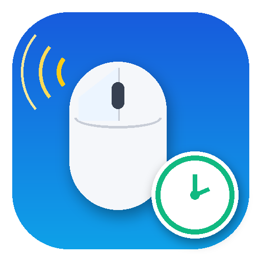

# 🖱️ AutoClicker Multi-Ponto (Linux & Windows)

<p align="center">
  
</p>

<p align="center">
  <b>Automação de cliques periódicos em 2 locais independentes com tempos e coordenadas customizáveis (Tempo X e Tempo Y).</b>
  <br />
  Suporte nativo para <b>Linux (GNOME Wayland & X11)</b> e <b>Windows 10/11 (x64)</b> com múltiplos monitores.
</p>

---

## ✨ Principais Recursos

- 📍 **Dois Pontos Independentes (Ponto 1 e Ponto 2)**:
  - Temporizadores separados para cada ponto (**Tempo X** e **Tempo Y**).
  - Configuração individual de minutos, segundos adicionais e atalhos rápidos.
  - Seleção de botão do mouse (Esquerdo, Direito, Meio) e modo de clique (Simples ou Duplo).
  - Interruptor para ativar/desativar cada ponto individualmente.
- 🖥️ **Suporte a Múltiplos Monitores (Multi-Monitor)**:
  - Mira em tela cheia que cobre **todas as telas simultaneamente**.
  - Detecção e cálculo de offset global para cliques em qualquer monitor.
- 🎯 **Captura Fácil na Tela ("Marcar na Tela")**:
  - Clique no botão e depois no local desejado da tela para salvar as coordenadas exatas `(X, Y)`.
  - Opção de digitar as coordenadas manualmente ou alternar para clicar onde o cursor estiver.
- ⌨️ **Atalho Global de Inicialização**:
  - No Windows: pressione **F6** a qualquer momento (mesmo dentro de jogos ou em segundo plano) para iniciar ou pausar.
- 💾 **Salvamento Automático das Configurações**:
  - As coordenadas, intervalos e preferências são salvos automaticamente em disco (`~/.config/autoclicker/config.json` no Linux ou `%APPDATA%\AutoClicker\config.ini` no Windows).
  - Ao reabrir o app, todas as opções continuam salvas!
- 🧪 **Teste Individual de Ponto**:
  - Botão de teste imediato em cada alvo para validar o clique antes de iniciar o ciclo automático.
- 🔊 **Notificação Sonora**:
  - Som sutil de confirmação a cada clique efetuado (pode ser ativado/desativado).

---

## 🪟 Windows (Executável Standalone)

O aplicativo conta com uma versão nativa em C para Windows compilada em 64-bit, sem dependências externas, que não necessita instalação:

- **Download Direto:** [`release/AutoClicker.exe`](release/AutoClicker.exe) (apenas ~73 KB)
- **Atalho rápido:** Pressione **F6** para Iniciar / Parar a qualquer momento.

---

## 🐧 Linux (GNOME Wayland & X11)

### Interface Gráfica Moderna (GTK 4 + Libadwaita)
Inicie pelo menu de aplicativos do GNOME ou pelo terminal:
```bash
autoclicker
```

### Modo Terminal (CLI)
Para executar em linha de comando ou em servidores/background:
```bash
# Ponto 1 a cada 2 min em (2200, 650) e Ponto 2 a cada 5 min em (450, 700):
autoclicker --cli -m1 2 -x1 2200 -y1 650 -m2 5 -x2 450 -y2 700

# Sem coordenadas fixas (clica onde o mouse estiver no momento):
autoclicker --cli -m1 1 -m2 3
```

---

## 🛠️ Como Compilar

Para recompilar tanto o backend Linux (`ei_clicker`) quanto o executável Windows (`AutoClicker.exe`):

```bash
./build.sh
```

---

## 📂 Estrutura do Repositório

```
autoclicker/
├── autoclicker.ico      # Ícone do aplicativo para Windows (16x16 até 256x256)
├── autoclicker.png      # Ícone em alta resolução (512x512)
├── autoclicker.svg      # Ícone vetorial SVG
├── backend.py           # Motor de cliques e persistência (Linux)
├── gui.py               # Interface gráfica GTK 4 + Libadwaita (Linux)
├── cli.py               # Interface de terminal CLI (Linux)
├── main.py              # Ponto de entrada do Python (Linux)
├── ei_clicker.c         # Emulador nativo libei para GNOME Wayland
├── build.sh             # Script de compilação automatizada (Linux e Windows)
├── windows/
│   ├── main.c           # Aplicação nativa Win32 (Windows)
│   ├── resources.rc     # Arquivo de recursos com ícone embutido
│   └── app.manifest     # Manifesto Common Controls v6 e Per-Monitor DPI
├── release/
│   └── AutoClicker.exe  # Executável portátil para Windows 64-bit (~73KB)
└── README.md
```

---

## 📄 Licença

Distribuído sob a licença MIT.
